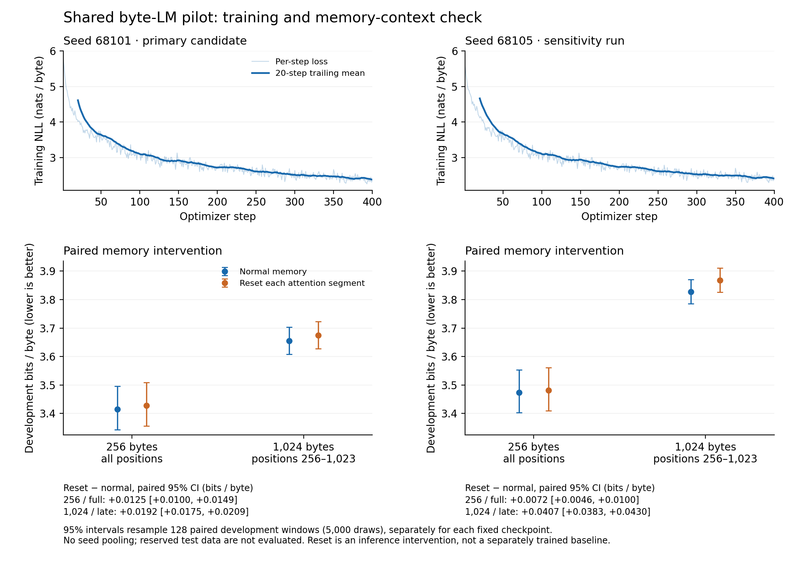

# Shared training baseline after the group sync

The transcript received on November 14 supports a smaller common baseline for both proposals: retain the working lucidrains implementation, develop sleep and Hebbian modifications separately, and share training and evaluation infrastructure. The team's latest `main` commit, `1e8de19`, adds `clmm/pretrain`, `clmm/sleep`, and `clmm/hebbian`; this local branch incorporates it. The transcript has no reliable speaker labels, so it does not establish individual task ownership. Its discussion of a changed report deadline is also unverified.

## Scope decision

Use one compact, complete sequence model before implementing every architecture in the older roadmap. The existing symbolic Reader and pressure experiments remain the controlled mechanism testbed. They do not contain attention or a language-model backbone and are not relabeled as pretrained language-model weights.

The new `clmm.pretrain` adapter builds the vendored `MemoryAsContextTransformer` with token embeddings, segmented causal attention, persistent key/value pairs, neural memory, feedforward layers and a next-byte head. Despite the upstream class name, this is the lucidrains approximation, not a paper-faithful MAC reproduction. The neural-memory output enters the residual stream before attention. No upstream source has been modified.

For scale context, Titans §5.1 reports FineWeb-Edu training at 15B tokens for its 170M/340M/400M models and 30B for 760M, with a Llama 2 tokenizer and 4K training context. The current enwik8 byte pilot is an engineering and integration check, not a comparison with those reported scores. Source: [Titans v1, §5.1](https://arxiv.org/html/2501.00663v1#S5.SS1), checked November 14.

## Explicit pilot choices

These are local experimental settings; they do not fill the team's decision register or claim PR approval.

| Register areas | Pilot configuration |
|---|---|
| A1/A2/A4 | Gradient refresh every 32 positions; memory update/retrieval chunks of 8; causal last-completed-chunk retrieval from the implementation |
| A5/A6/A7 | Two-layer 32→64→32 GELU memory per head; learned initialization; learned gates; inner-step cap 0.01 |
| A8/A9/A12 | Upstream residual/norm memory wrapper enabled; squared reconstruction error averaged over features; four memory heads |
| A10/A11 | Differentiate within each training window; reset memory between independent windows |
| B2/B4/B7 | Upstream q/k RMS normalization; four learned persistent key/value pairs per attention layer |
| C/D | Two layers, width 128, four attention heads, 32-byte attention segments, no inserted long-term tokens; RoPE and upstream axial positions; float32 |

The adapter materializes zero-stride per-head parameters into independent contiguous storage before optimizer creation. Their initialized values and shapes are unchanged. This resolves an AdamW in-place-update error found by the optimizer test; the affected names are stored in the checkpoint provenance. It is an explicit compatibility adjustment, not a change to the vendored update equations.

## Training and evaluation contract

`scripts/train_shared_byte_lm.py` uses the existing `data/enwik8.gz`. Its decoded bytes and compressed file are hashed. Training uses bytes `[0, 90M)`, development `[90M, 95M)`, and reserves `[95M, 100M)` without evaluation. Windows include the next-byte target and cannot cross split boundaries. This split is by byte position, not by document; the development region is not an untouched final test after repeated use.

The two fixed initialization seeds are 68101 and 68105. Both receive identical training offsets from seed 68102, 400 optimizer steps, batch size 16, and 256 predicted bytes per window: 1,638,400 predicted training bytes each. AdamW uses learning rate 0.0003, weight decay 0.01 and gradient clipping at 1. Final checkpoints are used without selecting the better dev score. Seed 68101 is the primary candidate; seed 68105 measures sensitivity.

The resolved model has 839,248 registered parameters. Both CPU runs use two threads and run concurrently on a machine exposing 16 logical processors. Their elapsed times are operational measurements under shared load, not a controlled hardware-performance comparison.

The fixed development set contains 128 nonoverlapping 1,025-byte blocks sampled on a seeded grid. Short evaluation uses the same blocks' first 257 bytes. Per-window loss sums and byte counts support NLL and bits per byte at lengths 256 and 1,024, with positions 256–1,023 also reported separately. Uncertainty resamples whole windows jointly across conditions, conditional on each checkpoint and sampled corpus blocks. It does not measure variation across all training runs or documents.

Three conditions distinguish useful context from general loss improvement:

- **Normal:** unmodified forward computation.
- **Zero memory readout:** removes the retrieved neural-memory contribution. Writes still execute, and downstream layer inputs may change. This is not an independently trained attention-only model.
- **Memory reset at each attention segment:** keeps the within-segment memory computation and original transformer positions, while removing memory from previous segments. It is restricted to full-sequence evaluation and rejects cached decoding.

Execution completion, baseline adequacy, and memory usefulness are separate outcomes. The pilot requires finite completion, exact reload logits, prefix causality, fixed weights during evaluation, and at least a 0.2-nat/byte development improvement. A stronger context-use result additionally requires normal memory to improve late long-window NLL over segment-reset with a positive lower paired interval. Neither criterion establishes factual retention or a sleep-timing benefit.

## Completed pilot results

Both fixed runs completed all 400 steps and seven evaluation groups. Seed 68101 took 780.2 seconds and seed 68105 took 781.4 seconds, including evaluation. Both had exact checkpoint-reload logits, zero measured prefix-causality difference, finite losses/gradients, nonzero memory gradients and unchanged outer weights during evaluation. Both pass the prospectively specified baseline and memory-context criteria.

| Initialization seed | Final dev bits/byte, length 256 | Final normal bits/byte, late positions of length 1,024 | Reset minus normal, late bits/byte [paired 95% interval] |
|---|---:|---:|---:|
| 68101 — primary | 3.4153 | 3.6556 | +0.0192 [+0.0175, +0.0209] |
| 68105 — sensitivity | 3.4740 | 3.8269 | +0.0407 [+0.0383, +0.0430] |

Lower loss is better; a positive reset-minus-normal difference favors retaining memory across attention segments. The corresponding late normal-versus-reset NLL improvements are 0.01334 and 0.02819 nats/byte. Removing the memory readout entirely increases late loss by 0.06982 and 0.09670 bits/byte, respectively. These are inference interventions in the trained models, conditional on the fixed development windows, not independent trained-model comparisons. Both checkpoints are retained, with 68101 remaining primary as planned.

This establishes a working sequence-model baseline with a small, repeatable benefit from its memory context on this development sample. It does not establish long-term fact retention, revision handling, or a sleep-replay advantage. The 1,024-byte evaluation also extends beyond the 256-byte training window, and absolute late loss is higher; useful memory alone does not establish reliable long-context extrapolation.

The independent artifact audit passed for both runs: it checked source/data/checkpoint hashes, split boundaries, exact shared training and development arrays, full budgets, finite checkpoint tensors, and reconstructed all loss aggregates and paired-window intervals. It audits saved evidence rather than independently repeating inference. Its own checks rejected corrupted split boundaries, altered loss totals, nonfinite checkpoint tensors and changed source snapshots. See [verified decisions](../results/shared-pretrain-2026-11-14/analysis/decisions.json) and [metrics](../results/shared-pretrain-2026-11-14/analysis/estimates.csv).



Per-condition intervals describe variation across development windows. The smaller paired differences and their intervals are printed separately beneath each panel; overlapping per-condition intervals do not replace the paired analysis.

## How the team can use it

```python
from clmm.pretrain import load_checkpoint
model, config, record = load_checkpoint("checkpoint.pt", map_location="cpu")
model.eval()
```

The checkpoint has a versioned architecture/configuration schema, tensor state, source hashes and training metadata. Loading rejects incompatible models, wrong configurations and nonfinite weights. It can provide a shared initialization and a reproducible evaluation target. A Hebbian replacement still needs a compatible state/update/read adapter; arbitrary replacement modules are not automatically checkpoint-compatible.

Keep two later comparisons distinct: (1) frozen shared representations to inspect mechanisms or transfer, and (2) separately adapted complete models with matched training examples, outer updates and declared compute. Replacing Titans memory in a Titans-trained checkpoint alone is not a fair architecture comparison. Keep the fact/revision/interference probes alongside language loss, then add varied heldout language templates and cross-session state tests. Do not rely solely on needle retrieval.

## Next experiment and remaining team choices

1. Freeze this checkpoint/data/configuration contract as an integration baseline. Both tracks can load seed 68101; use 68105 as the already fixed sensitivity checkpoint. Neither checkpoint is presented as a large pretrained language model or a completed paper baseline.
2. Serialize the existing fact/revision/distractor streams into byte sequences for this complete model. Train and evaluate on separate fact assignments and templates, with losses restricted to declared answer positions for the task metric. Validate recent-fact acquisition and revised-answer accuracy before increasing fact count and delay. Keep stable old facts and deliberately superseded facts separate so desired updating is not mislabeled as forgetting.
3. Add the sleep intervention behind the same state/write/read contract, then compare online updates, repeated-current updates, continuous replay and periodic replay on identical streams. Match outer training, memory-update examples and replay opportunities, and separately report buffer bytes and wall time. Keep the earlier symbolic evidence and the new sequence-model results separate.
4. Integrate a Hebbian implementation through an explicit adapter, testing initialization, state reset, causality and compatible readout dimensions first. A frozen-backbone experiment can diagnose transfer; a fair comparison between update rules also needs matched adaptation of the complete models.

The team still needs to settle the exact Hebbian rule and gating, whether the main claim concerns replacement or an additional memory module, and the primary sequence-level retention/revision task. The byte tokenizer and enwik8 are pilot defaults, not a requirement for the final benchmark. FineWeb-Edu-scale pretraining and all paper architecture variants are outside this immediate experiment. These choices are recorded for later team review; no assignment to a particular speaker is inferred from the transcript.

## Evidence and operating history

The focused adapter tests check data boundaries, raw/gzip equivalence, reproducible windows, causal logits, independent writable head storage, finite memory gradients and optimizer updates, exact checkpoint reload, and restoration/semantics of both ablations. Runner tests cover deadline enforcement, nonfinite heldout loss, and byte-weighted metrics. The previous 91 reference/replay/pressure checks remain part of validation.

A two-step CPU end-to-end smoke run completed. An earlier smoke attempt failed before training because the loader initially expected uncompressed input; it is preserved. The GPU allocation encountered shared-filesystem stalls and later SSH loss before any full language-model training was launched. A prospective execution amendment moved both fixed full runs to the tested local CPU environment without changing their training or data budgets. The separately planned weak-checkpoint auxiliary-decay diagnostic is tracked independently; incomplete remote outputs are not evidence. The last SSH reconnect attempt timed out, so the final status/release of the one-hour allocation 13905404 could not be verified. The unrelated job 13905360 was not stopped or modified.

Full artifacts: `C:/Users/henry/Documents/Codex/2026-10-22/i/outputs/clmm-shared-pretrain-2026-11-14`. Source for the fixed pilots: commit `8cc20ac`. No weights or team messages have been published, and no GitHub push, PR, merge into main, or baseline tag movement is claimed.
